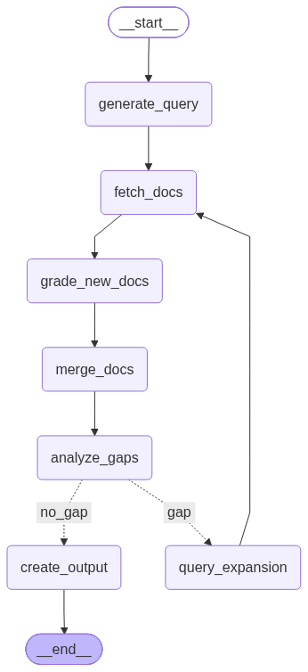
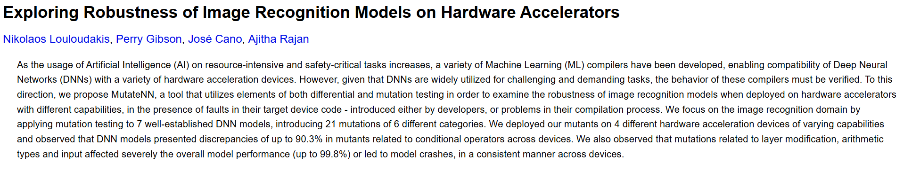
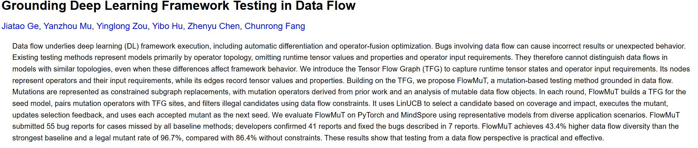
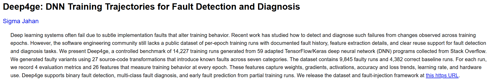

# Research Assistant RAG
This repository contains a demo project illustrating how to implement an agentic Retrieval Augmented Generation (RAG) system using LangChain and the vector database Qdrant.

The research assistant takes a user query as input and follows an iterative retrieval and evaluation process. First, the agent reformulates the original query into a search query optimized for retrieval from the vector database. It then retrieves the top matching documents from Qdrant and evaluates each document based on its relevance to the original user query, assessing how well the corresponding paper addresses the research question.

The retrieved documents are subsequently merged with the collection of previously retrieved documents. Based on the accumulated results, the agent determines whether sufficient information has been gathered to answer the user's question. If the available documents are deemed insufficient, the agent formulates a new search query and repeats the retrieval and evaluation process. This iterative procedure continues until the agent determines that the retrieved information is sufficient to address the original query.

The overall workflow is illustrated in the figure below:

## Example
If we use the user query "I am working on a research project to adapt mutation testing from classical software engineering to deep learning systems. What are existing ideas on this topic?", the three highest ranking papers are the following:

Clearly, these papers are very relevant for the given user query.

The agent fetched these papers using the following queries:
1. "mutation testing for deep learning systems neural network mutation operators fault injection"
2. "mutation testing deep learning software engineering test adequacy criteria oracle problem mutation operators survey"

## Components

This section provides an overview of the main components and technologies used in the project.

### LangChain

[LangChain](https://www.langchain.com/) is used to implement the agent and define its underlying execution graph. It orchestrates the individual steps of the agentic RAG pipeline, including query formulation, document retrieval, relevance assessment, and iterative retrieval.

### Qdrant

[Qdrant](https://qdrant.tech/) serves as the vector database. It was chosen for its efficient approximate nearest neighbor search capabilities and its support for storing arbitrary JSON payloads alongside vectors, allowing additional metadata to be associated with each document.

### Google AI Studio

[Google AI Studio](https://aistudio.google.com/) is used to access the Gemini model for inference, specifically `gemini-3.5-flash-lite`. For embedding generation, the `Qwen/Qwen3-Embedding-0.6B` model is executed locally. This avoids reliance on external embedding APIs and helps prevent API rate limits from becoming a bottleneck.

### Langfuse

[Langfuse](https://langfuse.com/) is used for observability and tracing. It provides detailed insights into the agent's execution by logging individual steps and tracking metrics such as token consumption, latency, and execution traces. This facilitates debugging, performance analysis, and monitoring of the overall retrieval pipeline.

### Data Source

The vector database is populated using a randomly selected 10% subset of abstracts from the [Cornell University arXiv dataset on Kaggle](https://www.kaggle.com/datasets/Cornell-University/arxiv/). To restrict the dataset to machine learning research, only papers belonging to the `cs.LG` (Machine Learning) category are considered.
